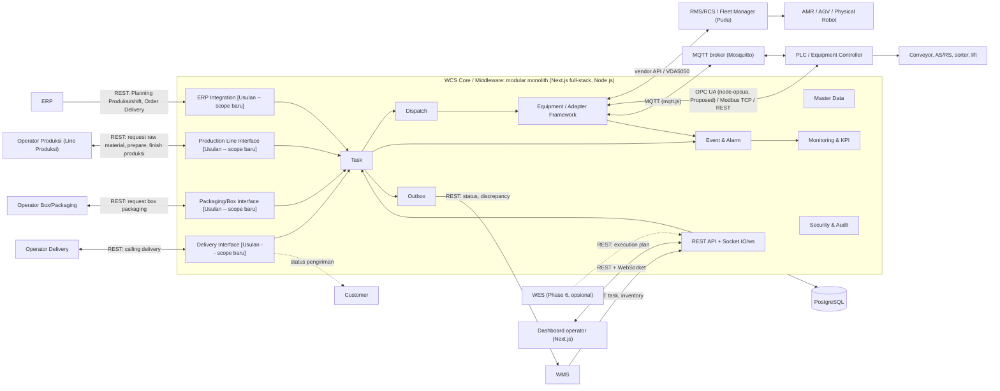

# Arsitektur Smart WCS Platform

Pelengkap `ADR.md` (keputusan stack) untuk output Phase 0 "Architecture" (PRD §13). Menjawab: komponen dan batasnya, pemetaan ISA-95 (PRD §4), tabel interface (PRD §10), kontrak real-time (PRD §8, §10), aturan dispatching (FR-03), target non-fungsional (PRD §8), dan aturan kapan WES diperlukan (PRD §5).

Penanda: **[PRD]** = bersumber langsung dari PRD. **[Usulan]** = usulan engineering, belum disepakati Astra/Winteq. **[Revisi 2026-10-05]** = berubah akibat revisi stack (Next.js full-stack) dan perluasan scope end-to-end (lihat `ADR.md` Section 1.1 dan 2).

## 1. Konteks sistem dan komponen [Revisi 2026-10-05]

**Perubahan dari versi sebelumnya [Revisi 2026-10-05]:**
- WCS Core disebut juga **"Middleware"** (istilah dari referensi arsitektur operasional) -- posisinya jadi orchestrator di antara ERP (hulu) dan RMS/RCS (hilir), bukan hanya penerima task dari WMS.
- Stack internal pindah dari Spring Boot ke **Next.js full-stack (Node.js)**; real-time channel pindah dari WebSocket/STOMP ke **Socket.IO/`ws`** (lihat `ADR.md` Section 2-3).
- Empat modul baru **[Usulan -- scope baru]**: ERP Integration, Production Line Interface, Packaging/Box Interface, Delivery Interface -- masing-masing jadi *task source* baru, konsisten dengan prinsip Task API source-agnostic (`ADR.md` Section 8.1). Detail FR diusulkan di `ADR.md` Section 1.1 (FR-13 s/d FR-16).
- ERP sekarang terhubung **langsung** ke WCS (lewat modul ERP Integration), bukan cuma garis putus-putus ke WMS seperti versi sebelumnya -- kedua jalur (WMS dan ERP) tetap ada dan perlu functional boundary yang jelas soal source of truth data (`ADR.md` Section 5).

Aturan antar modul (ADR Section 8.2): modul berkomunikasi lewat event internal, bukan memanggil langsung -- di Next.js diimplementasikan lewat event emitter internal (mis. Node `EventEmitter` atau util setara) menggantikan `ApplicationEventPublisher` Spring. Package/folder per bounded context: `task`, `dispatch`, `equipment` (termasuk `adapter`), `event`, `masterdata`, `security`, `monitoring`, `integration` (outbox, API key), plus empat folder baru: `erp-integration`, `production-line`, `packaging`, `delivery` **[Usulan -- scope baru]**.

Batas tanggung jawab antar sistem ada di `FUNCTIONAL_BOUNDARY.md`; kontrak Adapter di `ADAPTER_CONTRACT.md`; konvensi API di `API_CONVENTIONS.md`.

## 2. Pemetaan ISA-95 [PRD §4]

ISA-95 dipakai sebagai referensi pembagian fungsi, bukan penempatan wajib sebuah software pada level tertentu.

| Area | Sistem | Tanggung jawab |
| --- | --- | --- |
| Business / Enterprise | ERP / Business System | Kebutuhan bisnis, demand, purchasing, planning, **planning produksi/shift dan order delivery customer [Revisi 2026-10-05, Usulan]** |
| Warehouse Management | WMS / WES | Inventory, warehouse operation, planning, scheduling, prioritas pekerjaan |
| Production | Line Produksi (Operator Produksi) | Assembly/rakit, request raw material, serah-terima finish good **[Revisi 2026-10-05, Usulan]** |
| Packaging | Operator Box/Packaging | Persiapan box, packaging finish good sebelum outbound **[Revisi 2026-10-05, Usulan]** |
| Warehouse Execution | WCS / RCS | Menjalankan task, memilih equipment, dispatching, routing, koordinasi robot/equipment -- **kini juga orchestrator antara ERP dan RMS/RCS [Revisi 2026-10-05]** |
| Machine Control | PLC / Robot Control System (RCS/RMS) | Sequence mesin, sensor, actuator, gerakan robot |
| Physical Process | AMR / Conveyor / AS/RS / Robot | Perpindahan dan handling material secara fisik |
| Delivery | Operator Delivery / Customer | Pengiriman finish good dari warehouse ke customer **[Revisi 2026-10-05, Usulan]** |

## 3. Tabel interface [PRD §10]

| Interface | Mekanisme | Data | Rincian di |
| --- | --- | --- | --- |
| WMS → WCS | REST API / event | Task, status task, completion, exception, inventory | `API_CONVENTIONS.md` §2, §8 |
| WMS/WES → WCS | REST API / event | Task/plan, priority, constraints, status eksekusi | idem |
| **ERP → WCS [Revisi 2026-10-05, Usulan]** | REST API (`Get Method`) | Planning Produksi per shift (tipe, qty, line), Order Delivery (waktu, tipe, qty customer) | `API_SPECIFICATION.md` modul ERP Integration |
| **Operator Produksi ↔ WCS [Revisi 2026-10-05, Usulan]** | REST API | Request raw material (tipe/qty/line), progress prepare, finish produksi percycle, calling AMR | `API_SPECIFICATION.md` modul Production Line Interface |
| **Operator Box/Packaging ↔ WCS [Revisi 2026-10-05, Usulan]** | REST API | Request box packaging, status box kosong | `API_SPECIFICATION.md` modul Packaging Interface |
| **Operator Delivery ↔ WCS [Revisi 2026-10-05, Usulan]** | REST API | Calling robot untuk delivery, status pengiriman ke customer | `API_SPECIFICATION.md` modul Delivery Interface |
| WCS → RCS | Vendor API (VDA5050 bila didukung) | Mission/task, state robot, error | `ADAPTER_CONTRACT.md` |
| WCS → PLC | OPC UA (**node-opcua, Proposed** [Revisi 2026-10-05]) / adapter (Modbus TCP, REST bila perlu) | Command equipment, state, interlock/status | `ADAPTER_CONTRACT.md` |
| WCS ↔ IoT/Event | MQTT (**mqtt.js** [Revisi 2026-10-05]) | Telemetry dan event | Bagian 4 di bawah |
| WCS → Dashboard | REST + **Socket.IO/`ws`** [Revisi 2026-10-05] | Telemetry, status, event/alarm | Bagian 4 di bawah |
| WCS → Database | SQL (**Prisma** [Revisi 2026-10-05]) | Master, transaction, event, audit | `ERD.md` |

Pemilihan protokol disesuaikan per project. Perintah terkait keselamatan tetap di sistem safety; WCS tidak menggantikannya [PRD §10].

## 4. Kontrak real-time [PRD §8, §10; rinci: Usulan]

PRD §8: untuk informasi real-time gunakan mekanisme event (WebSocket atau MQTT), bukan polling terus-menerus.

**Socket.IO/`ws` di custom Node server (WCS → Dashboard) [Revisi 2026-10-05 -- menggantikan Spring WebSocket/STOMP, pola topik di bawah tetap dipertahankan sebagai kontrak]**
- Endpoint: `/api/v1/ws` (dijalankan dari custom Node server, bukan Next.js API route serverless -- lihat `ADR.md` Section 3). Autentikasi: token JWT dikirim saat handshake koneksi (`auth` payload Socket.IO atau query param untuk `ws`); role mengikuti RBAC (hak baca topik sama dengan hak baca endpoint REST-nya).
- Topik/channel (hanya server yang publish; klien hanya subscribe) -- nama topik dipertahankan sama supaya kontrak ke konsumen dashboard tidak berubah:

| Topik | Payload | Pemicu |
| --- | --- | --- |
| `/topic/tasks` | `TaskEvent` (taskId, status, failureCode, changedAt) | Setiap transisi status task |
| `/topic/tasks/{taskId}` | `TaskEvent` | Idem, per task |
| `/topic/equipment/{equipmentId}/status` | `EquipmentStatus` | Pembaruan status/posisi |
| `/topic/robots/{robotId}/status` | `RobotStatus` | Pembaruan status/posisi/battery |
| `/topic/alarms` | `AlarmEvent` (alarmId, status, severity, eventType) | Alarm dibuat, di-acknowledge, di-clear |
| `/topic/connections` | `ConnectionEvent` (systemName, status, lastSeenAt) | Perubahan status koneksi |

- Setiap pesan membawa `eventId` dan `occurredAt`. Setelah reconnect, klien memuat ulang state lewat REST (pesan tidak diputar ulang).

**MQTT (equipment/IoT ↔ WCS)**
- Struktur topik: `wcs/{warehouseId}/{resourceType}/{resourceId}/{channel}` dengan `resourceType` = `equipment` atau `robot`, `channel` = `status` (dari perangkat, QoS 1, retained), `event` (dari perangkat, QoS 1), `command` (dari WCS, QoS 1).
- Payload JSON UTF-8, timestamp ISO 8601 UTC. Bila vendor memakai format sendiri (mis. VDA5050), Adapter menerjemahkannya; format vendor tidak bocor ke WCS Core.
- Broker tunggal (ADR Section 5): HA ditunda sampai sebelum production.

## 5. Aturan dispatching [PRD FR-03; kriteria rinci: Usulan]

PRD: WCS memilih resource berdasarkan status, capability, lokasi, battery/energy, dan aturan yang dikonfigurasi; fleet-level allocation AMR dan kontrol gerak robot dilakukan RCS.

1. **Ambil task**: dari status QUEUED, urut `priority` (nilai lebih kecil = lebih prioritas), lalu `createdAt` terlama.
2. **Filter kandidat** (semua harus terpenuhi): status resource tersedia (`ONLINE`/`IDLE`); `capabilities.taskTypes` memuat `taskType` task; zone resource sesuai zone lokasi asal; untuk robot, `battery >= wcs.dispatch.min-battery-percent` (usulan 20); ada Route aktif untuk pasangan lokasi asal-tujuan dan `resourceType`.
3. **Urutkan kandidat**: jarak ke lokasi asal terdekat (memakai koordinat Node bila `Location.nodeId` terisi, jika tidak: satu zone dulu), lalu yang paling lama idle.
4. **Hasil**: satu resource, ASSIGNED; jika kosong task tetap QUEUED dan dicoba lagi di siklus berikutnya; lewat batas tunggu menjadi `NO_RESOURCE_AVAILABLE` (lihat `TASK_STATE_MACHINE.md`).
5. Untuk AMR: WCS menyerahkan mission ke RCS; pilihan robot spesifik di dalam fleet oleh RCS bila RCS mendukungnya. Area abu-abu #1 (siapa memutuskan "robot perlu charging") belum terjawab; ambang battery di atas adalah asumsi sementara.

Semua ambang dan bobot adalah konfigurasi (`wcs.dispatch.*`), bukan hardcode [PRD §3 Configuration over Customization].

## 6. Target non-fungsional [PRD §8; angka: Usulan]

PRD §8 menyebut kategori dan arah, tetapi menyerahkan angka ke SLA project. Angka di bawah adalah titik awal untuk skala Simple (≤20 task aktif, ≤5 robot) dan harus disetujui Astra/Winteq.

| Kategori | Kebutuhan [PRD] | Target awal [Usulan] |
| --- | --- | --- |
| Performance | Target waktu respon jelas per fungsi/API; real-time lewat event | API baca p95 < 500 ms, API tulis p95 < 1 s; event status sampai ke dashboard < 2 s setelah terjadi |
| Availability | Stabil sesuai SLA project; restart dan pulih dengan baik | Ditentukan per project; awal: layanan otomatis restart (Docker `restart: unless-stopped`), pulih < 2 menit setelah crash |
| Scalability | Dapat menambah warehouse/zone/equipment/robot tanpa ubah struktur utama | Beban uji sampai 100 task aktif dan 20 robot (batas Intermediate) tanpa perubahan skema |
| Interoperability | Interface umum; perbedaan vendor di adapter | Semua integrasi lewat `ADAPTER_CONTRACT.md`; Adapter baru tidak mengubah WCS Core |
| Observability | Log, status, alarm, riwayat aktivitas | Log JSON terstruktur dengan `taskId`/`traceId`; metrik dasar (Actuator/Micrometer): jumlah task per status, latensi dispatch, status koneksi |
| Recovery | Menangani koneksi putus, timeout, task gagal; retry, pengecekan ulang, lanjut dengan aman | Sesuai `TASK_STATE_MACHINE.md`; backup database harian, restore teruji |
| Security | Akses sesuai kebutuhan; password dan credential aman; komunikasi aman; aktivitas tercatat | Hash password bcrypt/argon2; credential integrasi terenkripsi (AES-GCM, kunci dari secret environment); API key disimpan sebagai hash; TLS untuk komunikasi antar sistem walau di LAN; audit log (FR-11) |
| Maintainability | Mudah dikembangkan; API/konfigurasi/komponen terkelola; testing berkala | OpenAPI sebagai kontrak; tes integrasi per modul; checklist konformansi Adapter |
| Data Integrity | ID unik, status dan waktu jelas, tidak ada transaksi ganda, jejak aktivitas | PK UUID; transaksi atomik pada transisi status; idempotensi `externalRef`; audit |

## 7. Aturan kapan WES diperlukan [PRD §5]

WES bukan komponen wajib; keputusan berdasarkan kompleksitas orkestrasi, bukan hanya jumlah AMR atau luas warehouse. Kategori Simple/Intermediate/Complex bukan klasifikasi resmi ISA-95/IEC 62264, tetapi internal engineering guideline yang akan dievaluasi dari project aktual [PRD §5.1, §5.2].

**Kriteria kualitatif [PRD §5.1]**

| Kriteria | Simple | Intermediate | Complex |
| --- | --- | --- | --- |
| Equipment | Sedikit jenis, proses sederhana | Beberapa jenis | Banyak jenis yang harus dikoordinasikan |
| Task | Sedikit dan sederhana | Beberapa berjalan bersamaan | Banyak berjalan bersamaan |
| Scheduling | Tidak perlu | Sederhana | Dinamis, jadwal berubah |
| Priority | Sederhana | Beberapa tingkat | Berubah sesuai kondisi |
| Batching | Tidak perlu | Kadang diperlukan | Harus menggabungkan task |
| Resource | Tidak perlu pembagian beban | Pembagian sederhana | Pembagian beban antar equipment/zone |
| Optimization | Rule sederhana cukup | Optimasi dasar | Optimasi antar proses |
| Orchestration | WMS langsung memberi task ke WCS | Perlu WES | Koordinasi beberapa sistem/proses |

**Ambang kuantitatif [PRD §5.2]**

| Kriteria | Simple | Intermediate | Complex |
| --- | --- | --- | --- |
| Jenis equipment | ≤3 | 4-7 | >7 |
| Jumlah zone | ≤3 | 4-10 | >10 |
| Task aktif bersamaan | ≤20 | 21-100 | >100 |
| Jumlah robot/AMR | ≤5 | 6-20 | >20 |
| Level prioritas task | ≤2 | 3-4 | >4 |
| Jenis controller/equipment | ≤2 | 3-4 | >4 |
| Sistem yang perlu dikoordinasikan | ≤2 | 3-4 | >4 |
| Scheduling | Tidak perlu | Dasar | Dinamis |
| Batching task | Tidak perlu | Opsional | Diperlukan |
| Pembagian beban equipment | Tidak perlu | Dasar | Diperlukan |
| Perubahan jadwal | Tidak perlu | Terbatas | Diperlukan |

**Aturan penentuan [Usulan]**
1. Nilai setiap kriteria di atas untuk project; kategori project = kategori tertinggi yang dicapai oleh kriteria **orkestrasi** (Scheduling, Priority, Batching, Pembagian beban, Perubahan jadwal, Orchestration).
2. Kriteria jumlah (equipment, zone, task, robot, controller, sistem) yang melewati ambang Simple memicu **review arsitektur** (ADR Section 5), belum otomatis memutuskan WES.
3. Project Simple: WMS → WCS langsung. Intermediate atau Complex pada kriteria orkestrasi: rekomendasikan WES (Phase 6); WCS tetap source-agnostic sehingga WES masuk sebagai sumber task baru (ADR Section 8.1).
4. Hasil penilaian dicatat sebagai bagian dari ADR project dan dievaluasi ulang setiap akhir phase.
